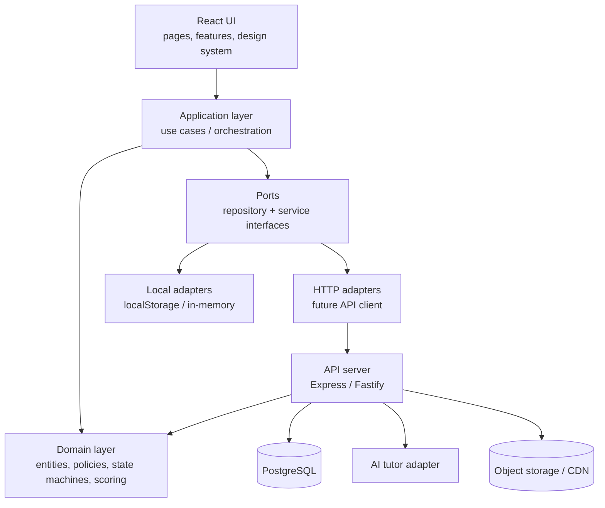
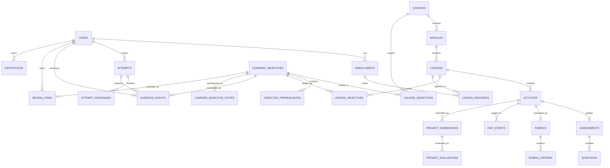

# Day 1 — Architecture and Data Model Proposal

**Status:** Design proposal. **Not implemented, not migrated, not executed.**
**Baseline:** commit `440cc0a`
**Companion draft schema:** [`schema.sql`](./schema.sql)
**Learning process:** [`LEARNING_JOURNEY.md`](./LEARNING_JOURNEY.md)

---

## 1. Goals and non-goals

### Goals

1. Replace the current disconnected demo logic with **one reusable learning engine**.
2. Make learning logic **pure, testable and framework-independent**.
3. Separate **content**, **learning rules**, **UI**, **persistence**, and **AI tutoring**.
4. Support every subject through **activity types and evaluators**, not separate engines.
5. Persist an **append-only evidence ledger** so mastery is explainable.
6. Keep a clean migration path from localStorage to a server-backed PostgreSQL model.
7. Let the current React application migrate incrementally without a rewrite.

### Non-goals for Day 1

- No backend, database or AI provider is added now.
- No application source code is changed.
- No claim that the draft schema has been executed.
- No attempt to preserve the current broken quiz/diagnostic behavior as a contract.

---

## 2. Architectural principles

| Principle | Consequence |
|---|---|
| **Domain first** | Scoring, mastery, scheduling and state transitions live in pure functions with no React or `localStorage`. |
| **UI is a client** | React components render view models and send intents; they do not calculate mastery. |
| **Ports and adapters** | The same use cases work with localStorage now and HTTP/PostgreSQL later. |
| **Evidence is append-only** | Attempts and evidence events are immutable; current state is a projection. |
| **Course-scoped identity** | No bare `lesson-1` across courses. All records use UUIDs; slugs are scoped. |
| **Content is data** | Lessons and activities are validated content, not hardcoded JSX branches. |
| **Deterministic adaptation** | Progression is decided by testable rules, not by an LLM. |
| **Server is authoritative (later)** | Clients submit responses; the server computes scores and mastery. |
| **Accessible by default** | Domain state is exposed as text, not color or emoji. |

---

## 3. Target layers



### Dependency rules

| Module | May import | Must never import |
|---|---|---|
| `domain/` | domain only, standard library | React, browser APIs, fetch, database clients |
| `application/` | domain, ports | React, concrete adapters |
| `infrastructure/` | ports, domain types | UI |
| `features/` / `ui/` | application, domain types, design system | database clients, raw fetch |
| `server/` | domain, application, DB adapters | React |
| `content/` | domain types, validation schemas | application/UI |

**Rule of thumb:** if a function needs `window`, `localStorage`, `fetch` or React to
decide a learning rule, it is in the wrong layer.

---

## 4. Proposed folder structure

```
src/
  app/
    router/
    providers/
    layout/
  features/
    auth/
    catalog/
    learn/
    review/
    passport/
    authoring/
  ui/
    primitives/          # Button, Dialog, Progress, Field
    patterns/            # ActivityShell, FeedbackPanel, StepIndicator
  domain/
    entities/            # Course, Lesson, Attempt, Evidence...
    value-objects/       # Score, HintBudget, MasteryRule
    learning/
      diagnostic.ts
      evidence.ts
      mastery.ts
      recommendation.ts
      error-analysis.ts
      review-scheduler.ts
      lesson-state-machine.ts
      hint-policy.ts
    content-validation.ts
  application/
    ports/
      repositories.ts
      clock.ts
      id-generator.ts
      tutor.ts
      media.ts
    use-cases/
      start-lesson.ts
      submit-attempt.ts
      get-next-activity.ts
      complete-review.ts
      verify-mastery.ts
      evaluate-project.ts
      get-learner-report.ts
  infrastructure/
    persistence/
      local/             # Day 2 adapter
      http/              # later API adapter
    ai/
      noop-tutor.ts      # Day 2
      grounded-tutor.ts  # later
    clock/
  content/
    courses/
      web-dev-101/
      python-basics/
      business-101/
    schemas/
  lib/
tests/
  unit/domain/
  integration/
  e2e/
server/                  # Phase 2
db/
  migrations/
```

Aliases already declared in `jsconfig.json` (`@/*`) can be adopted, but the Day 2
implementation should not mix aliases and relative imports randomly.

---

## 5. Domain model

### 5.1 Entity relationship diagram



### 5.2 Key modeling decisions

1. **UUID primary keys.** Human-readable slugs are scoped (`unique(module_id, slug)`),
   never global. This removes the current `lesson-1` collision.
2. **Objective graph is independent of courses.** Objectives belong to a subject and are
   reused by courses through `course_objectives` and `lesson_objectives`. This is what
   makes prerequisite detection reusable across subjects.
3. **Activities are first-class.** Explanation, demonstration, practice, retrieval,
   project and transfer are rows with a `kind`, not separate page components. The UI
   chooses a renderer from `kind`.
4. **Assessment is an extension of an activity.** Only graded activities have an
   `assessments` row. A diagnostic, practice quiz, mastery check and review can share the
   same question model.
5. **Attempts are immutable.** Corrections create a new attempt or an explicit void,
   never an overwrite. Responses are stored per question.
6. **Evidence is an append-only ledger.** Every mastery decision points to evidence
   events. `learner_objective_states` is a rebuildable projection, not the source of
   truth.
7. **Mastery policy is versioned data.** Thresholds, minimum evidence and hint rules are
   rows, not constants in React. Every result records `rule_version`.
8. **Review scheduling is separate.** `review_items` stores scheduler state; review
   completion produces evidence like any other attempt.
9. **Projects use rubrics.** Rubric criteria are structured rows; evaluations record the
   evaluator type (`auto`, `human`, `ai_assisted`) and scores.
10. **Certificates are server records.** The current client-written certificate result is
    replaced by a verification code and a mastery snapshot.

### 5.3 Entity summary

| Entity | Purpose | Important fields |
|---|---|---|
| `users` | Learner/author/admin identity | `email`, `display_name`, `role`, `password_hash` |
| `courses` | Published learning product | `slug`, `subject`, `status`, `version`, default policy fields |
| `modules` | Ordered course sections | `course_id`, `position`, `slug` |
| `lessons` | Concept-sized unit | `module_id`, `slug`, `position`, `estimated_minutes` |
| `learning_objectives` | Reusable capability | `subject`, `code`, `title`, `difficulty` |
| `objective_prerequisites` | Objective DAG edges | `objective_id`, `prerequisite_objective_id` |
| `course_objectives` | Course → objective mapping | `course_id`, `objective_id`, `is_required` |
| `lesson_objectives` | Lesson → objective mapping | `lesson_id`, `objective_id`, `is_primary` |
| `activities` | Any learner action | `lesson_id`, `kind`, `position`, `config` |
| `assessments` | Grading configuration | `activity_id`, `kind`, `passing_score`, `max_attempts`, `time_limit_seconds`, `hints_allowed` |
| `questions` | Assessment items | `assessment_id`, `kind`, `prompt`, `options`, `answer_key`, `explanation`, `objective_id` |
| `mastery_policies` | Configurable pass rules | `threshold`, `min_evidence`, `hints_allowed`, `require_apply`, `rule_version` |
| `rubrics` / `rubric_criteria` | Project evaluation | criteria, weights, max points |
| `enrollments` | Learner ↔ course | `status`, `enrolled_at`, `completed_at` |
| `lesson_progress` | Coarse persisted state | `state`, `mastery_verified_at`, `completed_at` |
| `attempts` | Immutable submission header | `score`, `status`, `duration_ms`, `hint_count` |
| `attempt_responses` | Per-question answers | `response`, `is_correct`, `points_awarded`, `error_category` |
| `evidence_events` | Append-only evidence ledger | `objective_id`, `state`, `score`, `source_attempt_id`, `rule_version` |
| `learner_objective_states` | Current projection | `state`, `best_score`, `evidence_count`, `mastered_at` |
| `review_items` | Spaced-repetition state | `ease_factor`, `interval_days`, `repetitions`, `due_at` |
| `hint_events` | Hint usage audit | `level`, `revealed_steps`, `total_steps` |
| `project_submissions` | Applied work | `artifact_url`, `content`, `status` |
| `project_evaluations` | Rubric result | `evaluator_type`, `scores`, `total_score`, `feedback` |
| `certificates` | Verifiable completion | `verification_code`, `mastery_snapshot` |
| `ai_interactions` | Tutor audit (optional) | `role`, `prompt_hash`, `grounded_refs`, `model` |

The executable draft is in [`schema.sql`](./schema.sql). It has **not** been run against
PostgreSQL; it is a design artifact for review.

---

## 6. Learning engine interfaces

The engine is a set of pure functions and a thin orchestration layer. The following
TypeScript-like signatures define the contract; the Day 2 implementation may start in
JavaScript with JSDoc types if TypeScript setup is deferred.

```ts
// ---------- Inputs / outputs ----------

export type EvidenceState =
  | "NOT_ASSESSED"
  | "NEEDS_PRACTICE"
  | "DEVELOPING"
  | "DEMONSTRATED"
  | "REVIEW_RECOMMENDED";

export interface DiagnoseInput {
  lessonId: string;
  objectiveIds: string[];
  prerequisiteGraph: ObjectiveEdge[];
  previousEvidence: EvidenceEvent[];
  availableQuestions: Question[];
  maxQuestions: number;          // default 5
}

export interface DiagnosticResult {
  questions: Question[];
  missingPrerequisites: string[];
  startingDifficulty: "foundation" | "standard" | "advanced";
  evidenceEvents: NewEvidenceEvent[];
}

export interface SubmitAttemptInput {
  learnerId: string;
  assessment: Assessment;
  questions: Question[];
  responses: Response[];
  startedAt: Date;
  submittedAt: Date;
  hintEvents: HintEvent[];
}

export interface AttemptResult {
  attemptId: string;
  score: number;
  perQuestion: QuestionResult[];
  errorCategories: ErrorCategory[];
  evidenceEvents: NewEvidenceEvent[];
  nextAction: Recommendation;
}

export interface Recommendation {
  type:
    | "review-prerequisite"
    | "read-explanation"
    | "guided-practice"
    | "targeted-practice"
    | "take-diagnostic"
    | "verify-mastery"
    | "apply"
    | "spaced-review";
  reasonCode: string;
  objectiveIds: string[];
  confidence: number;
}

export interface MasteryInput {
  learnerId: string;
  objectiveIds: string[];
  policy: MasteryPolicy;
  evidence: EvidenceEvent[];
  masteryAttempt: AttemptResult;
  applyRequired: boolean;
  applyPassed: boolean;
}

export interface MasteryResult {
  passed: boolean;
  ruleVersion: string;
  reasonCodes: string[];
  evidenceIds: string[];
}

export interface ReviewInput {
  item: ReviewItem;
  quality: 0 | 1 | 2 | 3 | 4 | 5;
  reviewedAt: Date;
}

// ---------- Engine ----------

export interface LearningEngine {
  diagnose(input: DiagnoseInput): DiagnosticResult;
  evaluateAttempt(input: SubmitAttemptInput): AttemptResult;
  analyzeErrors(attempt: AttemptResult): ErrorAnalysis;
  recommendNextActivity(input: RecommendationInput): Recommendation;
  verifyMastery(input: MasteryInput): MasteryResult;
  scheduleReview(input: ReviewInput): ReviewItem;
  transitionLesson(state: LessonState, event: LessonEvent): LessonState;
}
```

### 6.1 Scoring rules

- The **server/domain** computes scores from responses and `answer_key`; the client never
  sends a score.
- Partial credit is allowed per question (`points_awarded`).
- `score = sum(points_awarded) / sum(max_points) × 100`.
- Diagnostic scores create evidence but do not count as mastery evidence.
- Practice attempts count as evidence but not as the independent mastery check.
- Mastery requires a separate attempt with `kind = mastery` and `hints_used = 0`.
- The pass rule and inputs are stored so a result can be reproduced.

### 6.2 Evidence rules

| Evidence state | Rule |
|---|---|
| `NOT_ASSESSED` | No evidence events |
| `NEEDS_PRACTICE` | Score below threshold on practice, < 2 independent samples |
| `DEVELOPING` | Improving or threshold met with low confidence / one sample |
| `DEMONSTRATED` | Mastery policy satisfied with independent, hint-free evidence |
| `REVIEW_RECOMMENDED` | Repeated failures or retention decay after review |

Evidence events are never deleted. A later successful event can move the projection to
`DEMONSTRATED` without erasing earlier failures. One wrong answer does not trigger
`NEEDS_PRACTICE`; it triggers feedback and another sample.

### 6.3 Recommendation policy

The initial deterministic table is defined in
[`LEARNING_JOURNEY.md` §3, Stage 6](./LEARNING_JOURNEY.md#stage-6--adapt). It is a pure
function over:

- current evidence state and count
- missing prerequisites
- last error categories
- hint dependency ratio
- review due status
- attempt count in the session

The policy returns a reason code, which is stored with the recommendation. An LLM may
rephrase the message; it cannot override the decision.

### 6.4 Review scheduler

Use corrected SM-2 (see `LEARNING_JOURNEY.md` Stage 7). Keep the scheduler pure:

```
next(item, quality, now) -> new item
```

`due_at` is authoritative; clients only display it. Store `rule_version` with every
review update.

### 6.5 Lesson state machine

The persisted `lesson_progress.state` is coarse
(`not_started → in_progress → mastery_pending → mastered → completed → review_due`).
The nine-stage session state is richer and lives in the domain; it is emitted as events
and is not required to be a database enum.

**Invariant:** `mastered` cannot be reached without a `MasteryResult(passed=true)` whose
evidence IDs exist. `completed` additionally requires the course's Apply requirement.

---

## 7. Data access and use-case boundaries

### Repository ports

```ts
export interface CourseRepository {
  getCourse(courseId: string): Promise<Course | null>;
  getLesson(courseId: string, lessonId: string): Promise<Lesson | null>;
  listActivities(lessonId: string): Promise<Activity[]>;
}

export interface ProgressRepository {
  getEnrollment(learnerId: string, courseId: string): Promise<Enrollment | null>;
  getLessonProgress(enrollmentId: string, lessonId: string): Promise<LessonProgress | null>;
  saveLessonProgress(progress: LessonProgress): Promise<void>;
}

export interface AttemptRepository {
  createAttempt(input: NewAttempt): Promise<Attempt>;
  saveResponses(attemptId: string, responses: NewResponse[]): Promise<void>;
  listEvidence(learnerId: string, objectiveIds: string[]): Promise<EvidenceEvent[]>;
  appendEvidence(events: NewEvidenceEvent[]): Promise<EvidenceEvent[]>;
}

export interface ReviewRepository {
  listDue(learnerId: string, now: Date, limit: number): Promise<ReviewItem[]>;
  save(item: ReviewItem): Promise<void>;
}

export interface Clock { now(): Date; }
export interface IdGenerator { next(): string; }
export interface TutorPort { respond(input: TutorInput): Promise<TutorResponse>; }
```

### Use-case transaction rule

A submitted attempt is persisted atomically with its responses and evidence events:

```
1. validate attempt belongs to learner and assessment
2. load assessment + questions + answer keys (server only)
3. score responses in the domain
4. create attempt (immutable)
5. insert responses
6. append evidence events
7. update learner_objective_states projection
8. update lesson_progress if mastery passed
9. return view model + next recommendation
```

If step 6 or 7 fails, the transaction rolls back. There must be no attempt without
evidence, and no evidence pointing to a nonexistent attempt.

---

## 8. API proposal (Phase 2, not built)

REST is sufficient; GraphQL is unnecessary for the first version.

| Method | Endpoint | Purpose |
|---|---|---|
| `POST` | `/v1/auth/register` | Create account |
| `POST` | `/v1/auth/login` | Authenticate, set HTTP-only session |
| `POST` | `/v1/auth/logout` | End session |
| `GET` | `/v1/courses` | Published course catalog |
| `GET` | `/v1/courses/:courseId` | Course, modules, lessons, objectives |
| `GET` | `/v1/courses/:courseId/lessons/:lessonId` | Lesson + activities (no answer keys) |
| `POST` | `/v1/enrollments` | Enroll learner |
| `POST` | `/v1/lessons/:lessonId/diagnostics` | Start diagnostic |
| `GET` | `/v1/learners/me/progress` | Progress by course/objective |
| `POST` | `/v1/attempts` | Start an attempt |
| `POST` | `/v1/attempts/:attemptId/responses` | Save a response (draft) |
| `POST` | `/v1/attempts/:attemptId/submit` | Submit and score |
| `GET` | `/v1/learners/me/reviews` | Due review items |
| `POST` | `/v1/reviews/:reviewItemId/complete` | Record review quality |
| `POST` | `/v1/projects/:activityId/submissions` | Submit project |
| `POST` | `/v1/submissions/:submissionId/evaluate` | Human/auto evaluation |
| `GET` | `/v1/learners/me/report` | Learner intelligence report |
| `POST` | `/v1/tutor/messages` | Grounded tutor turn |
| `GET` | `/v1/certificates/:code` | Public certificate verification |

**Security rules**

- Never return `answer_key` or mastery thresholds that enable gaming before submission.
- Rate-limit attempts, tutor messages and login.
- Authoring endpoints require the `author`/`admin` role.
- All scores and mastery are server-computed.

---

## 9. Migration from the current application

### Phase 0 — Day 1 (complete)

- Audit, baseline, Git checkpoint, design documents. No source changes.

### Phase 1 — Stabilize and extract (Day 2)

1. Fix P0 defects D01–D04 and add a smoke test.
2. Add Vitest and a content validator.
3. Introduce domain types and pure scoring/mastery/scheduler functions.
4. Define the content schema and convert **one** existing lesson.
5. Implement a `LocalStorageRepository` behind the ports.
6. Build one lesson UI through Diagnose → Practise → Mastery → Apply stub.
7. Keep the existing static pages working; do not migrate all content at once.

### Phase 2 — Server and database

1. Add Express/Fastify API and PostgreSQL migrations from `schema.sql`.
2. Move auth to server sessions (Argon2id password hashes).
3. Move scoring/matery/evidence to the server.
4. Implement sync/import from localStorage for demo users.
5. Replace client certificate writes with server-issued certificates.

### Phase 3 — AI and scale

1. Add a grounded tutor adapter with retrieval over lesson content.
2. Add project rubrics and human review workflow.
3. Add analytics/reporting and multilingual content variants.
4. Add media storage/CDN and offline packs.

### localStorage mapping

| Current key | Target |
|---|---|
| `crushlearn_user` | `users` + `enrollments` |
| `completedLessons` | `lesson_progress` + evidence events |
| `lesson_<id>_progress` | `lesson_progress` metadata (activity progress) |
| `simulation_<id>` | `attempts` + `attempt_responses` |
| `diagnostic_answers_*` | diagnostic `attempts` + responses + evidence |
| `quiz_attempt_*` | practice `attempts` + responses |
| `final_skill_check_result` | mastery attempt + `certificates` |
| `certificate_locked` | derived from mastery, not a separate flag |
| `offline_mode` | client preference only (not a learning record) |

**Do not migrate demo passwords.** The current auth has no real credential to migrate.

---

## 10. Content authoring and validation

Content should be data (TypeScript objects or YAML/JSON) with a schema (Zod or JSON
Schema), validated in CI before seeding PostgreSQL.

### Required checks

- Every lesson has at least one primary objective.
- Every objective's prerequisites exist and the graph is acyclic.
- Every lesson has: explanation, demonstration, independent practice, mastery assessment.
- Every mastery assessment uses a task different from the practice item.
- Every question has an answer key, explanation and objective ID.
- Rubric criteria have positive weights; project activities have a rubric.
- Slugs are unique within their parent; UUIDs are globally unique.
- No course references a missing lesson or activity.
- Concept budget is within the configured 15–30% warning band (default 20%).
- No assessment leaks its answer key in client-facing content.

### Content boundary

- `content/` may import domain types and validators.
- `content/` must not import React, repositories or API clients.
- The same content package is used to seed the database and build the local demo.

---

## 11. Testing strategy

| Level | Tool | What it proves |
|---|---|---|
| Unit (domain) | Vitest | Scoring, mastery rules, evidence transitions, prerequisite cycles, SM-2, hint budget, state machine |
| Contract | Vitest | Local and HTTP repositories satisfy the same interface |
| Integration | Vitest + Supertest | API routes, transactions, authorization |
| Component | React Testing Library | Learner can complete a step, errors are announced, no color-only state |
| E2E | Playwright | One full lesson: diagnose → practice → feedback → mastery → apply |
| Content | custom script | All courses satisfy the authoring rules |
| Accessibility | axe + manual keyboard pass | WCAG 2.2 AA target |
| Security | dependency audit + route tests | No answer-key leakage, authz enforced |

### Minimum Day 2 test set

1. A wrong answer produces feedback and does **not** set `NEEDS_PRACTICE` from one sample.
2. A hint-free mastery attempt at 80% with 2 evidence samples passes.
3. The same score during practice does not pass mastery.
4. Completing `web-dev-101/lesson-1` does not affect `python-basics/lesson-1`.
5. A failed mastery attempt returns the learner to targeted practice.
6. SM-2 intervals match the expected sequence for q = 5, 4, 3, 2.
7. Review due dates are computed from the injected clock, not the system clock.
8. Evidence events are append-only and linked to attempts.

---

## 12. Security, privacy and integrity

- **Server-authoritative scoring.** Never trust client scores, mastery, or certificates.
- **Answer keys** stored server-side; no answer keys in public course payloads.
- **Auth:** Argon2id hashes, HTTP-only/SameSite cookies, short sessions, rate limiting.
- **RBAC:** learner, author, reviewer, admin.
- **Evidence integrity:** application role cannot update/delete `evidence_events`; use a
  restricted DB role and audit triggers.
- **Certificates:** server-issued, with a verification code and mastery snapshot; public
  verification endpoint reveals only name, course, date and status.
- **PII minimization:** no sensitive traits; no emotion inference; deletion supported.
- **AI safety:** course content is data, not instructions; prompt-injection filtering;
  grounded citations; log model/version; no certificate authority.
- **Media:** validate uploads, serve from object storage/CDN, no executable content.
- **Security headers/CSP** when a server exists.

The current demo has none of these. That is acceptable only while it remains a local
prototype.

---

## 13. Accessibility and performance

- WCAG 2.2 AA target; keyboard-complete flows; visible focus; labelled inputs.
- Feedback announced in a live region; state also expressed in text.
- Captions/transcripts for all video; alt text for instructional images.
- Mobile-first single column; ≥44 px touch targets.
- Code-split by route and heavy activity renderer.
- Lazy-load video and project artifacts; low-bandwidth text-first mode.
- Target budgets (initial proposal): LCP < 2.5 s on 4G, initial JS < 200 kB gzip for the
  learning route, no layout shift from media.

---

## 14. Risks and open decisions

| Risk | Mitigation |
|---|---|
| Content authoring cost across 7 subjects | Start with 2 lessons; build an authoring checklist and validator |
| Multiple-choice questions test recognition, not transfer | Require a mastery task that differs from practice; add Apply rubric |
| LLM grading unreliability | Deterministic checks first; AI advisory; human review for high stakes |
| Offline/local-first conflict | Define a sync protocol before implementing offline writes |
| Answer leakage in client bundles | Server-side answer keys from Phase 2; in Phase 1 accept demo-only limitation and label it |
| Over-generalizing too early | One lesson end-to-end, then a second subject |
| Review scheduler complexity | Correct SM-2 only; do not add FSRS/ML until data exists |
| Certificate trust | Server issuance + verification code, never localStorage |
| Multilingual content drift | Content variants keyed by language; UI strings separate from course text |

Decisions still needed: default thresholds per subject; whether Apply is mandatory; human
review capacity; language priority; offline scope; AI budget.

---

## 15. Day 2 implementation sequence

1. **Fix P0 only** (D01–D04) and add a smoke test; commit separately.
2. Add Vitest + React Testing Library and a `test` script.
3. Add `domain/` pure modules with tests (scoring, evidence, mastery, scheduler).
4. Define content schema and convert **one** lesson, including objectives and a mastery
   task distinct from practice.
5. Implement local repository + use cases with injected clock and IDs.
6. Build the single-lesson UI for Diagnose → Explain → Demonstrate → Practise → Feedback
   → Mastery → Apply stub.
7. Validate with the content script and E2E smoke.
8. Only then convert a second lesson in a **non-programming** subject to prove reuse.

**Do not start with the backend or the AI tutor.** They are Phase 2/3 and would hide
whether the learning engine actually works.

---

## 16. References

- [`AUDIT.md`](./AUDIT.md) — current-state evidence and defects
- [`BASELINE.md`](./BASELINE.md) — commands, environment, Git checkpoint
- [`LEARNING_JOURNEY.md`](./LEARNING_JOURNEY.md) — nine-stage process and policies
- [`schema.sql`](./schema.sql) — draft PostgreSQL schema (not executed)
