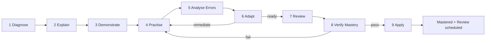
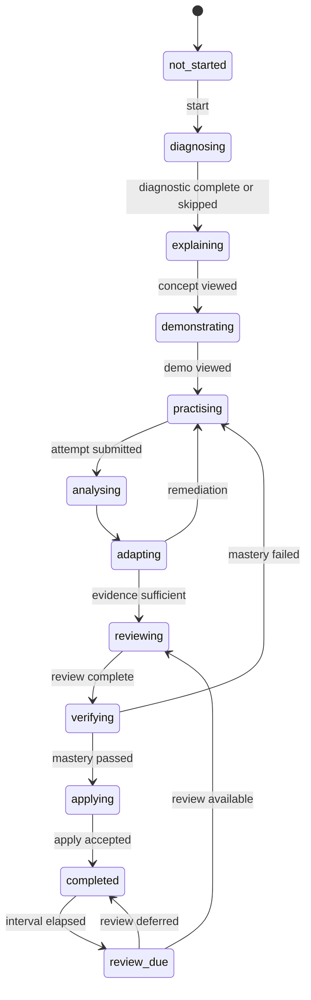

# Day 1 — Universal Learning Journey

**Status:** Design proposal. Not implemented.
**Applies to:** every course and subject.
**Related:** [`ARCHITECTURE.md`](./ARCHITECTURE.md), [`AUDIT.md`](./AUDIT.md)

---

## 1. Purpose

Define **one reusable learning process** that can support programming, mathematics,
science, languages, business, design and AI/ML without forcing every subject into the
same exercise format.

The engine owns the **process and evidence rules**. Courses supply **content and
subject-appropriate activities**. A course never re-implements progress, mastery or
review logic.

### Design principles

1. **Mastery before progress.** Time spent is not evidence of learning.
2. **Evidence over self-report.** Confidence is recorded but never substitutes for a
   demonstrated answer, artifact or explanation.
3. **Practice dominates.** The default budget is 20% concept and 80% practice; this is a
   configurable design target, not a scientific law.
4. **Failure is diagnostic.** A wrong answer opens feedback or a helper path; it does not
   permanently label the learner.
5. **No answer dumping.** Hints guide thinking; they never reveal a graded answer.
6. **Review is part of the loop**, not an afterthought.
7. **One engine, many activity types.** Subject differences live in activity content and
   evaluators, not in separate learning engines.
8. **Accessible by default.** Large targets, captions, keyboard paths, low-bandwidth
   options and reversible language choice.

---

## 2. Vocabulary

| Term | Definition |
|---|---|
| **Course** | A published collection of modules and lessons for one subject. |
| **Module** | A thematic group of lessons. |
| **Lesson** | One concept-sized unit that can be completed in one sitting. |
| **Learning objective** | A measurable capability, e.g. "Use variables to store and retrieve values". |
| **Activity** | Any learner action: explanation, demonstration, exercise, quiz, project, reflection. |
| **Assessment** | An activity that produces graded evidence. |
| **Attempt** | One immutable submission of an assessment. |
| **Evidence event** | An append-only record that a learner demonstrated (or failed to demonstrate) an objective. |
| **Mastery** | A rule-based judgment over multiple independent evidence events. |
| **Review item** | A scheduled retrieval of a previously learned objective. |

---

## 3. The nine-stage loop



The loop is a **session template**, not a rigid timer. A short lesson may compress stages;
a project lesson may loop through Practise → Analyse → Adapt several times.

### Stage 1 — Diagnose

**Purpose:** establish what the learner already knows and which prerequisites are missing.

| | |
|---|---|
| Learner experience | 3–5 short questions or one quick task, skippable when no prerequisites exist. |
| System behavior | Select questions from prerequisite objectives; score them; create initial evidence events. |
| Inputs | Learner ID, course/lesson ID, prerequisite objective graph. |
| Outputs | `DiagnosticResult`, missing prerequisite list, starting difficulty. |
| Evidence captured | Per-question correctness, time, confidence, hint use (usually none). |
| Gate | If prerequisites are missing, offer remediation. The learner may proceed only by completing remediation or explicitly accepting a "not yet assessed" state. |
| Subject adaptation | Programming: predict output. Maths: solve a short problem. Language: produce a sentence. Business: choose a decision. |

**Rules**

- Never label a learner "weak" from one wrong answer.
- Diagnose only what the lesson actually depends on.
- A diagnostic is optional when the lesson has no prerequisites.
- The result changes the starting point, not the mastery standard.

### Stage 2 — Explain

**Purpose:** introduce the concept with the minimum theory needed to attempt practice.

| | |
|---|---|
| Learner experience | Short explanation, key terms, one real-life context, optional `/ELI5` or `/ANALOGY`. |
| System behavior | Deliver concept blocks; record completion; no grading. |
| Outputs | Concept completion, optional self-confidence rating. |
| Gate | None; this is the 20% concept portion. |
| Subject adaptation | All subjects use text + media, but examples must be domain-specific. |

**Rules**

- Keep the concept budget near 20% of the lesson's estimated time.
- Explain *why* before *how* when the subject allows it.
- Link every explanation to the objective it serves.

### Stage 3 — Demonstrate

**Purpose:** show a worked example or expert performance the learner can imitate.

| | |
|---|---|
| Learner experience | Step-by-step worked example, annotated code, derivation, case walkthrough, or design critique. |
| System behavior | Present a complete example; allow step navigation; optionally ask prediction questions. |
| Outputs | Demo viewed; prediction attempts (optional). |
| Gate | None, but a prediction question can create early evidence. |
| Subject adaptation | Programming: annotated code execution. Maths: derivation. Science: experiment demo. Design: before/after critique. |

**Rules**

- The demonstration must be a model of the same activity the learner will perform.
- Do not use the exact graded task as the demonstration.
- Prediction prompts turn passive viewing into retrieval practice.

### Stage 4 — Practise

**Purpose:** move from guided practice to independent practice.

| | |
|---|---|
| Learner experience | 2–6 activities: guided exercise → independent exercise → retrieval quiz → project step. |
| System behavior | Serve activities by objective and difficulty; capture responses; allow hints within policy. |
| Outputs | Attempts, responses, hint events, time on task. |
| Evidence captured | Correctness, partial credit, error category, hint level, confidence. |
| Gate | At least one independent attempt is required before mastery verification. |
| Subject adaptation | See the subject matrix in §6. |

**Practice ladder**

1. **Guided practice** — partially completed example, high scaffolding.
2. **Independent practice** — new problem, no solution shown.
3. **Retrieval practice** — recall without notes.
4. **Transfer practice** — same concept in an unfamiliar context.

Hints are allowed in practice and are logged. They are not allowed during mastery
verification.

### Stage 5 — Analyse Errors

**Purpose:** turn mistakes into specific, actionable feedback.

| | |
|---|---|
| Learner experience | See which step failed, why, and one next action. |
| System behavior | Classify each error (conceptual, procedural, careless, prerequisite gap, misread); update evidence. |
| Outputs | `ErrorAnalysis` with category, severity, affected objective, suggested remediation. |
| Evidence captured | Error category per response; repeat-error counts. |
| Gate | None; this stage informs Adapt. |
| Subject adaptation | Programming: failing test vs syntax vs logic. Maths: sign/operation/concept. Writing: structure vs grammar vs evidence. |

**Rules**

- Feedback names the error, not the learner's ability.
- One wrong answer triggers a hint or follow-up, not a mastery failure.
- Repeated errors on the same objective escalate to remediation.
- Explanations are stored with the question so feedback is consistent.

### Stage 6 — Adapt

**Purpose:** choose the next best activity based on evidence.

| | |
|---|---|
| Learner experience | Either another practice item, a simpler explanation, a prerequisite review, or advancement. |
| System behavior | Deterministic policy using evidence state, error pattern, hint dependency and attempts. |
| Outputs | `NextActivityRecommendation` with reason code and confidence. |
| Gate | Loop back to Practise if not ready; proceed to Review/Verify if evidence is sufficient. |
| Subject adaptation | Same policy; different activity catalog. |

**Initial policy (deterministic, replaceable)**

| Condition | Recommendation |
|---|---|
| No evidence | Take diagnostic |
| Prerequisite missing | Review prerequisite objective |
| Score < 50% or repeated conceptual errors | Simpler explanation + guided practice |
| Score 50–79% | Targeted practice on failed objectives |
| Score ≥ 80% but low confidence/one sample | One more independent item |
| Score ≥ 80% with multiple independent samples | Verify mastery |
| Hint dependency > 0.5 | Practice with reduced hints |
| Review due | Spaced review before new material |

Do not use an LLM to make the progression decision. The policy must be testable and
explainable. AI may phrase the recommendation, not decide it.

### Stage 7 — Review

**Purpose:** consolidate before verification and schedule long-term retention.

| | |
|---|---|
| Learner experience | A short retrieval set or refresh reel covering earlier objectives. |
| System behavior | Pull due items from the review queue; score retrieval; update intervals. |
| Outputs | Review result, next due date, updated ease/interval. |
| Gate | A due review should be completed before a new mastery check on the same objective, unless the learner explicitly defers. |
| Subject adaptation | Same scheduler; different prompt types. |

**Scheduling rules (SM-2 style, corrected)**

- Quality `q` is 0–5 derived from correctness + confidence + hint use.
- If `q < 3`: reset repetitions, interval = 1 day.
- Else: interval = 1 day (first), 6 days (second), `round(previous_interval × ease_factor)` thereafter.
- Ease update: `EF' = max(1.3, EF + (0.1 − (5 − q) × (0.08 + (5 − q) × 0.02)))`.
- Long-term review continues after mastery; it does not re-lock the course by default.

### Stage 8 — Verify Mastery

**Purpose:** prove independent understanding under assessment conditions.

| | |
|---|---|
| Learner experience | A short, hint-free assessment using a **new** task, not the practice item. |
| System behavior | Serve assessment; enforce time/hint policy; score; write evidence; decide mastery. |
| Outputs | `MasteryResult` (passed/failed), score, evidence events, remediation plan. |
| Gate | Passing unlocks Apply and lesson completion. |
| Subject adaptation | Programming: new problem. Maths: unfamiliar problem. Language: new communication task. Design: new brief. Business: new case. |

**Default mastery rule (course-configurable)**

```
PASS if:
  independent assessment score >= 80%
  AND at least 2 independent evidence events for the objective
  AND no hints used during verification
  AND no unresolved prerequisite gap
```

Adjust thresholds per course, but record the rule version with every result. A single
assessment is not automatically "mastery" for high-stakes skills.

**On failure:** return to targeted practice, not to the beginning. Preserve the failed
attempt as evidence.

### Stage 9 — Apply

**Purpose:** transfer the skill to a realistic, unfamiliar situation.

| | |
|---|---|
| Learner experience | A project, case, experiment, communication task or design artifact with a rubric. |
| System behavior | Accept submission; evaluate against rubric (automated + human/LLM-assisted, clearly labeled); record evidence. |
| Outputs | `ProjectEvaluation`, rubric scores, feedback, portfolio artifact. |
| Gate | Apply is required for course completion where the course defines it. |
| Subject adaptation | Programming: working project. Maths: modeling task. Science: experiment report. Language: real communication. Business: decision memo. Design: portfolio piece. AI/ML: trained/evaluated model. |

**Rules**

- Rubrics are published before submission.
- Automated evaluation must state its limits.
- AI feedback is advisory; a human or deterministic check decides high-stakes outcomes.

---

## 4. Lesson state machine



### State invariants

- A lesson cannot enter `verifying` without at least one independent practice attempt.
- `completed` requires mastery; Apply is required only when the course declares it.
- Every transition writes an event (`lesson_transition`) with timestamp and reason.
- Failed mastery does not erase previous evidence.
- Time spent never changes state by itself.

---

## 5. The 20/80 budget

| Bucket | Default | Contents |
|---|---:|---|
| Concept | 20% | Diagnose, Explain, Demonstrate |
| Practice | 80% | Guided practice, independent practice, retrieval, error review, review, mastery check, apply |

- The budget is **estimated minutes or activity weight**, declared per lesson.
- It is configurable per course and per learner level.
- Remediation can temporarily exceed 80% practice; record the deviation.
- Do not claim this ratio is scientifically optimal. It is a product design target.

---

## 6. Subject matrix

| Subject | Concept examples | Practice activities | Mastery evidence | Apply artifact |
|---|---|---|---|---|
| Programming | Syntax, semantics, mental model | Predict output, write code, debug, tests | New problem solved without hints | Working mini-project |
| Mathematics | Definitions, theorems, derivation | Worked → new problems, error hunts | Unfamiliar problem with justification | Modeling task |
| Physics / science | Principles, variables, units | Predict, simulate, measure, explain | Explains and applies a principle | Experiment report |
| Languages | Vocabulary, grammar, register | Recall, sentence production, dialogue | Communicates in a new situation | Recording / written piece |
| Business | Frameworks, metrics | Case decisions, prioritization, critique | Justifies a decision with evidence | Decision memo |
| Design | Principles, critique vocabulary | Create, compare, revise | Produces work meeting a rubric | Portfolio artifact |
| AI/ML | Data, models, evaluation | Experiment, tune, evaluate | Builds and evaluates a working model | Reproducible notebook/report |

**Rule:** a subject may add activity types, but it may not bypass the evidence ledger or
the mastery gate.

---

## 7. Learning commands

Commands are **entry points into the same engine**, not separate applications. Each maps
to a stage and a service call.

| Command | Primary stage | Engine behavior | Guardrail |
|---|---|---|---|
| `/FROMZERO` | Diagnose → Explain | Build prerequisite path, start at the earliest gap | Do not skip diagnostics silently |
| `/FIRSTPRINCIPLES` | Explain | Derive the concept from axioms/definitions | Cite the course objective |
| `/ELI5` | Explain | Simplify language and examples | Do not change the assessed standard |
| `/ANALOGY` | Explain | Map concept to a familiar domain | State where the analogy breaks |
| `/KNOWLEDGEGAPS` | Diagnose / Adapt | Run prerequisite checks, list missing objectives | Distinguish "not assessed" from "weak" |
| `/ACTIVE_RECALL` | Practise / Review | Ask retrieval questions, no options shown initially | No answer reveal before attempt |
| `/DELIBERATE_PRACTICE` | Practise | Target the weakest objective with repeated variants | Log hint use |
| `/ERROR_ANALYSIS` | Analyse Errors | Classify mistakes, show cause and next action | Never insult or label the learner |
| `/MASTERYCHECK` | Verify Mastery | Hint-free new assessment | Do not reuse the practice item |
| `/SPACED_REPETITION` | Review | Pull due items, update intervals | Do not re-lock completed lessons by default |
| `/TRANSFER` | Apply | Present an unfamiliar context | Rubric must be visible |
| `/PROJECTBASED` | Apply | Guide a project through milestones | AI assists; deterministic/human check decides |
| `/RESEARCHGAP` | Apply / Explain | Identify unanswered questions and evidence needs | Label uncertainty; no fabricated citations |

---

## 8. AI tutor contract

The tutor is a **course-grounded guide**, not an answer machine.

### Roles

| Role | Behavior |
|---|---|
| **Thinking Coach** | Ask questions that direct attention to the next reasoning step. |
| **Mistake Mirror** | Reflect the learner's error back with a concrete comparison. |
| **Path Guide** | Recommend the next objective, review or practice item. |

### Hint policy

- Hints are graded:
  - **H1** — attention cue ("check the loop boundary").
  - **H2** — strategy cue ("trace the value after the second iteration").
  - **H3** — partial worked step, never the final graded answer.
- Operational cap: `revealed_solution_steps / total_solution_steps ≤ 0.45`.
- During `verifying`, hints are disabled.
- Every hint event is logged with activity, level and timestamp.
- `hint_dependency_ratio = hint_events / attempts` is reported, not used to punish.

### Grounding

- Retrieve only from the active course, lesson and objective texts.
- Cite the lesson/objective ID in tutor metadata.
- If the answer is not in the course, say so; do not invent content.
- Never generate a certificate or mastery result.

### Privacy

- Do not infer emotion, caste, religion, health or other sensitive traits.
- Store only what the learning rules need.
- Let learners delete their data.

---

## 9. Analytics and learner report

### Events to record

| Event | Key fields |
|---|---|
| `lesson_started` | learner, course, lesson, timestamp |
| `diagnostic_completed` | score, missing objectives, time |
| `activity_viewed` | activity, duration |
| `attempt_submitted` | assessment, responses, score, duration |
| `hint_used` | activity, level, timestamp |
| `error_classified` | attempt, error category, objective |
| `recommendation_issued` | type, reason code, confidence |
| `review_completed` | item, quality, next due |
| `mastery_verified` | objective, rule version, evidence IDs |
| `project_evaluated` | rubric version, scores, evaluator type |

### Report metrics

- Time-to-mastery (primary)
- Attempts per objective
- Hint dependency ratio
- Error category distribution
- Review retention / forgetting recovery
- Transfer/apply score
- Progress by objective, not videos watched

Reports must be understandable to learners, parents and mentors. Never present a single
score as a claim about intelligence or employability.

---

## 10. Accessibility, language and low bandwidth

- WCAG 2.2 AA target: keyboard reachability, visible focus, labels, contrast, captions.
- Large touch targets (≥ 44×44 px) and single-column mobile flow.
- Captions/transcripts for video; text alternative for audio.
- Low-bandwidth mode: text-first, lazy media, downloadable lesson packs.
- Language selection is visible and reversible; store the preference.
- Simple English by default; Hinglish and regional languages are content variants, not a
  separate engine.
- Do not use color alone to communicate state.

---

## 11. Worked examples

### Programming lesson — "Variables"

| Stage | Example |
|---|---|
| Diagnose | Predict what `x = 3; x = x + 1` prints. |
| Explain | Variable = named storage; assignment order matters. |
| Demonstrate | Annotated trace of three assignments. |
| Practise | Guided: fill the missing line. Independent: write a swap. |
| Analyse | Classify "uses value before assignment" as a conceptual error. |
| Adapt | Serve one more trace + a simpler analogy. |
| Review | Retrieval: define variable, predict output. |
| Verify | New problem: compute the final value of two variables, no hints. |
| Apply | Build a small tip calculator. |

### Business lesson — "Unit economics"

| Stage | Example |
|---|---|
| Diagnose | Choose which cost is variable for a café. |
| Explain | Contribution margin, fixed vs variable cost. |
| Demonstrate | Worked example for a subscription business. |
| Practise | Guided: classify costs. Independent: compute margin for a new case. |
| Analyse | Distinguish "wrong formula" from "misread data". |
| Adapt | Provide a simpler case or a targeted calculation drill. |
| Review | Recall the margin formula. |
| Verify | New case, no hints, justify the decision. |
| Apply | Write a one-page pricing recommendation with evidence. |

The same states, rules and services drive both.

---

## 12. Day 2 implementation scope

Build **one complete lesson** end-to-end before generalizing:

1. Content schema for one lesson with one objective and 3 practice items.
2. Domain engine: diagnostic scoring, attempt scoring, error classification, adapt policy.
3. Local repository (localStorage adapter) behind the same interface the future API uses.
4. UI: Diagnose → Explain → Demonstrate → Practise → Feedback → Mastery → Apply stub.
5. Tests: scoring, prerequisite blocking, evidence transition, review scheduling.
6. Only then migrate a second lesson and a non-programming subject.

**Definition of done for the first lesson:** a new learner can start from zero, make a
mistake, receive targeted feedback, retry, pass a hint-free mastery check, and see the
result persisted after reload — with tests proving the rules.

---

## 13. Guardrails and anti-patterns

- ❌ Unlocking the next lesson because a video ended.
- ❌ Marking mastery from one multiple-choice question.
- ❌ Showing the correct answer before an attempt.
- ❌ Using an LLM as the sole grader for high-stakes work.
- ❌ Treating "time on site" as learning.
- ❌ Calling an unassessed objective "weak".
- ❌ Reusing the practice question verbatim in the mastery check.
- ❌ Punishing hint use instead of measuring dependency.
- ❌ Forcing every subject into code-runner exercises.

---

## 14. Open decisions

1. Default mastery threshold per subject (80% is a starting point, not a universal rule).
2. Whether Apply is mandatory for every lesson or only course completion.
3. Human review capacity for project rubrics.
4. Offline sync conflict policy when the backend arrives.
5. Which languages are content variants versus UI translations.
6. How much AI is allowed to phrase feedback without changing the deterministic outcome.
